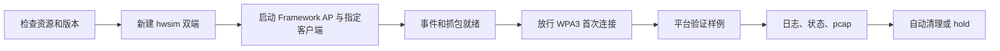

# ReconnectGuard 底层实验平台

## 运行

在项目根目录执行；实验运行需要 sudo。可以让codex帮你下。

当系统 Python 低于 3.10 时，可以保留系统版本并在仓库内创建隔离环境：

```sh
conda create --prefix .venv python=3.11 pip -y
bash scripts/setup.sh
```

项目脚本会优先使用 `.venv/bin/python`，并清除外部 `PYTHONPATH`，避免 ROS 等全局 Python 包混入实验。`setup.sh` 会同时构建 Framework 扩展版 AP 和官方未修改的 `wpa_supplicant 2.10`；`--client stock` 默认使用后者，不替换系统 `/usr/sbin/wpa_supplicant`。可通过 `RG_STOCK_WPA_SUPPLICANT` 显式覆盖客户端二进制路径。

| 操作 | 命令 |
|---|---|
| 准备依赖与固定版本 | `bash scripts/setup.sh` |
| 检查基础工具和控制通道测试 | `bash scripts/check.sh` |
| Framework 双端连接 | `sudo bash scripts/start.sh --client framework --probe connect` |
| 原版客户端 AP Deauth 示例 | `sudo bash scripts/start.sh --client stock --probe deauth` |
| 主动断开 / 重连控制检查 | `sudo bash scripts/start.sh --client stock --probe reconnect` |
| 保持环境运行 | 在上述命令后加 `--hold` |
| 单独关闭保持运行的环境 | 另一终端执行 `sudo bash scripts/stop.sh` |
| 核实 Deauth 抓包 | `sudo vendor/wifi-framework/setup/venv/bin/python scripts/inspect_trace.py results/<run_id>` |

## 运行链路



## 目录

| 目录 / 文件 | 职责 |
|---|---|
| rg_platform/lab.py | hwsim、命名空间、进程、控制适配、基础快照、清理 |
| rg_platform/control.py | 标准协议 / Framework 前缀；独立命令和监听连接 |
| rg_platform/journal.py | 单轮线程安全事件序号与多读者游标 |
| backends/platform_observer.py | 真实 Observer 事件标准化、过滤、去重与快照映射 |
| rg_platform/probes.py | 平台能力验证函数与注册表，不是完整 Executor |
| rg_platform/stop.py | 核实进程身份后停止本平台 |
| configs/ | 固定 WPA3 AP/客户端配置（需要我们再确认下）；密码仅供隔离虚拟实验 |
| scripts/ | 依赖准备、启停、静态检查、抓包核实 |
| tests/ | 命令协议与断开后查询回归测试 |
| vendor/ | 固定版本第三方依赖，不纳入自有代码 |
| results/ | 每轮证据；默认不提交 Git |
| work/ | 构建、安装日志与依赖锁定输出 |

## 每轮输出

| 文件 | 内容 |
|---|---|
| meta.json | 版本、配置、PHY、进程世代、原始命令响应 |
| ap.log / sta.log | 双端原始输出 |
| ap-events.jsonl / sta-events.jsonl | 平台验证用原始事件，不是最终 Observer 格式 |
| events.jsonl / observer-events.jsonl | 统一原始序号 / Observer 标准事件 |
| observer-observations.jsonl | Observer 过滤的候选事件及原因 |
| *-observer.json / observer-check.json | 标准快照 / 真实 Observer 平台检查 |
| connected_baseline.json | 已连接基线与 PMKSA |
| post_deauth_observed.json | Deauth 后实际观测；可能已进入重连 |
| post_disconnect.json | 主动断开样例的状态 |
| post_reconnect.json | 恢复后的状态 |
| trace.pcap / capture.log | 报文及抓包进程记录 |
| platform-check.json | 平台检查，不是漏洞结论 |
| frame-check.json | 单独执行抓包核实脚本后生成 |
| cleanup.json / error.json | 清理结果 / 发生错误时的记录 |

## 扩展新的断开验证

| 步骤 | 做法 |
|---|---|
| 1 | 在 probes.py 新建函数，参数为 lab |
| 2 | 保存 connected_baseline，记录动作开始时间 |
| 3 | 调用 lab.command 发送目标端控制命令，写清 semantic |
| 4 | 等待实际事件；不要将 OK 当作动作效果 |
| 5 | 保存动作后实际快照，验证恢复及进程连续性 |
| 6 | 加入 PROBES 注册表；命令行自动出现新选项 |
| 7 | 独立核验对应帧与日志，未知结论保留 unknown |

现有 `deauth(lab)` 只是参考模板。后续 Executor 接入时复用平台控制层请和我陈家森沟通。


WiFi Framework参考：[Wi-Fi Framework](https://github.com/domienschepers/wifi-framework)。

## 王奥鑫第一阶段模拟原型

无需 Linux 或 sudo，使用 Python 3.10+：

```sh
python3 runner.py --case client_disconnect_reconnect
python3 runner.py --scenario noisy_events
python3 -m unittest discover -s tests -v
```

`--scenario disconnect_timeout` 和 `--scenario reconnect_timeout` 演示失败记录，退出码为 1。输出位于 `results/<run_id>/`，所有结果标记为模拟数据。真实平台尚未接入上层 Runner。

设计、状态图、接口、配置格式及验收范围见 [第一阶段设计说明](docs/phase1-design.md)。

团队接手步骤、建议分工、接口待确认项和已知限制见 [第一阶段交接单](docs/handoff-phase1.md)。

真实 Observer 的责任边界、映射规则、输出样例与限制见 [Observer 适配器设计](docs/observer-design.md)。
