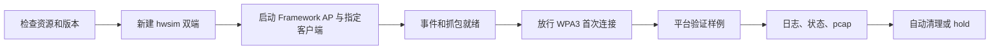

# ReconnectGuard 底层实验平台

## 运行

在项目根目录执行；实验运行需要 sudo。可以让codex帮你下。

当系统 Python 低于 3.10 时，可以保留系统版本并在仓库内创建隔离环境：

```sh
conda create --prefix .venv python=3.11 pip -y
bash scripts/setup.sh
```

项目脚本会优先使用 `.venv/bin/python`，并清除外部 `PYTHONPATH`，避免 ROS 等全局 Python 包混入实验。`setup.sh` 会同时构建 Framework 扩展版 AP 和官方未修改的 `wpa_supplicant 2.10`；`--client stock` 默认使用后者，不替换系统 `/usr/sbin/wpa_supplicant`。可通过 `RG_STOCK_WPA_SUPPLICANT` 显式覆盖客户端二进制路径。

| 操作 | 命令 |
|---|---|
| 准备依赖与固定版本 | `bash scripts/setup.sh` |
| 检查基础工具和控制通道测试 | `bash scripts/check.sh` |
| Framework 双端连接 | `sudo bash scripts/start.sh --client framework --probe connect` |
| 原版客户端 AP Deauth 示例 | `sudo bash scripts/start.sh --client stock --probe deauth` |
| 原版客户端 AP Disassoc 示例 | `sudo bash scripts/start.sh --client stock --probe disassoc` |
| 主动断开 / 重连控制检查 | `sudo bash scripts/start.sh --client stock --probe reconnect` |
| 保持环境运行 | 在上述命令后加 `--hold` |
| 单独关闭保持运行的环境 | 另一终端执行 `sudo bash scripts/stop.sh` |
| 核实 Deauth 抓包 | `sudo vendor/wifi-framework/setup/venv/bin/python scripts/inspect_trace.py results/<run_id>` |

## 运行链路



## 目录

| 目录 / 文件 | 职责 |
|---|---|
| rg_platform/lab.py | hwsim、命名空间、进程、控制适配、基础快照、清理 |
| rg_platform/control.py | 标准协议 / Framework 前缀；独立命令和监听连接 |
| rg_platform/journal.py | 单轮线程安全事件序号与多读者游标 |
| backends/platform_executor.py | 客户端断开/重连、AP Deauth/Disassoc 动作回执 |
| backends/platform_observer.py | 真实 Observer 事件标准化、过滤、去重与快照映射 |
| rg_platform/probes.py | 平台能力验证函数与注册表，不是完整 Executor |
| rg_platform/stop.py | 核实进程身份后停止本平台 |
| configs/ | 固定 WPA3 AP/客户端配置（需要我们再确认下）；密码仅供隔离虚拟实验 |
| scripts/ | 依赖准备、启停、静态检查、抓包核实 |
| tests/ | 命令协议与断开后查询回归测试 |
| vendor/ | 固定版本第三方依赖，不纳入自有代码 |
| results/ | 每轮证据；默认不提交 Git |
| work/ | 构建、安装日志与依赖锁定输出 |

## 每轮输出

| 文件 | 内容 |
|---|---|
| meta.json | 版本、配置、PHY、进程世代、原始命令响应 |
| ap.log / sta.log | 双端原始输出 |
| ap-events.jsonl / sta-events.jsonl | 平台验证用原始事件，不是最终 Observer 格式 |
| events.jsonl / observer-events.jsonl | 统一原始序号 / Observer 标准事件 |
| observer-observations.jsonl | Observer 过滤的候选事件及原因 |
| *-observer.json / observer-check.json | 标准快照 / 真实 Observer 平台检查 |
| connected_baseline.json | 已连接基线与 PMKSA |
| post_deauth_observed.json | Deauth 后实际观测；可能已进入重连 |
| post_disconnect.json | 主动断开样例的状态 |
| post_reconnect.json | 恢复后的状态 |
| trace.pcap / capture.log | 报文及抓包进程记录 |
| platform-check.json | 平台检查，不是漏洞结论 |
| frame-check.json | 单独执行抓包核实脚本后生成 |
| cleanup.json / error.json | 清理结果 / 发生错误时的记录 |

## 扩展新的断开验证

| 步骤 | 做法 |
|---|---|
| 1 | 在 probes.py 新建函数，参数为 lab |
| 2 | 保存 connected_baseline，记录动作开始时间 |
| 3 | 调用 lab.command 发送目标端控制命令，写清 semantic |
| 4 | 等待实际事件；不要将 OK 当作动作效果 |
| 5 | 保存动作后实际快照，验证恢复及进程连续性 |
| 6 | 加入 PROBES 注册表；命令行自动出现新选项 |
| 7 | 独立核验对应帧与日志，未知结论保留 unknown |

`deauth(lab)` 和 `disassoc(lab)` 是底层平台 smoke probe，用来核实 AP 控制接口和双端断开事件。
统一 Runner 的动作接口见 [组员接口说明](docs/platform-api.md)；Executor 已提供四种动作，
但 AP Deauth/Disassoc 仍需由 Runner/EFSM 负责人接入完整测试案例。


WiFi Framework参考：[Wi-Fi Framework](https://github.com/domienschepers/wifi-framework)。

## 王奥鑫第一阶段模拟原型

无需 Linux 或 sudo，使用 Python 3.10+：

```sh
python3 runner.py --case client_disconnect_reconnect
python3 runner.py --case ap_deauth
python3 runner.py --case ap_disassoc
python3 runner.py --scenario noisy_events
python3 -m unittest discover -s tests -v
```

`--scenario disconnect_timeout` 和 `--scenario reconnect_timeout` 演示失败记录，退出码为 1。输出位于 `results/<run_id>/`，所有结果标记为模拟数据。统一 Runner 现已支持 `--backend real`；模拟模式保持兼容。

设计、状态图、接口、配置格式及验收范围见 [第一阶段设计说明](docs/phase1-design.md)。

团队接手步骤、建议分工、接口待确认项和已知限制见 [第一阶段交接单](docs/handoff-phase1.md)。

真实 Observer 的责任边界、映射规则、输出样例与限制见 [Observer 适配器设计](docs/observer-design.md)。

## 统一 Runner：真实实验入口

| 操作 | 命令 |
|---|---|
| 真实主动断开与显式重连 | `sudo python3 runner.py --backend real --client stock` |
| 真实 AP Deauth 案例 | `sudo python3 runner.py --case ap_deauth --backend real --client stock` |
| 真实 AP Disassoc 案例 | `sudo python3 runner.py --case ap_disassoc --backend real --client stock` |
| 连续十轮 | `sudo python3 runner.py --backend real --client stock --repeat 10` |
| 独立 Python 环境 | 将 python3 换为 `.venv/bin/python` |

对另外三位成员的调用接口、字段、时序与输出责任，统一见 [组员接口说明](docs/platform-api.md)。旧阶段一交接单是历史记录，当前接口以这份说明和代码为准。真实 Runner 已接入客户端主动断开、AP Deauth 和 AP Disassoc；AP 案例使用自动恢复模式，仍需在 Linux hwsim 上完成真实验证，不代表完整安全 Oracle 已完成。

## 三路径对照调度

```sh
python3 comparison.py --backend mock --repeat 10
# Linux hwsim 环境中执行真实实验
sudo python3 comparison.py --backend real --client stock --repeat 10
```

输出批次计划、逐轮证据、JSON 汇总和 CSV 比较表。恢复耗时引用已接受的事件；覆盖统计限定为流程模型转换。实验条件、阶段状态及真实验收步骤见 [王奥鑫后续交付](docs/wang-phase4-delivery.md)。

阶段五新增结果分离、上下文历史和检查器接口。成员接入任务及仍待依赖的重试设计见 [阶段五交接](docs/phase5-handoff.md)。

## 中期检查器与失败恢复接入

单案例和对照入口现支持 `--evaluator module:factory`，每轮新建检查器实例。默认仍为未评估，不代表安全检查通过。mock 有界恢复示例、真实依赖及最新验证记录见 [王奥鑫中期代码交接](docs/wang-midterm-code-handoff.md)。

实际检查器已交付，加载名 `observer.oracle:Oracle`（例如 `python3 runner.py --case ap_deauth --evaluator observer.oracle:Oracle`）。判定规则与证据引用格式见 [检查器交付](docs/wang-oracle-delivery.md)，Kali 真实验证与真实帧号见 [验证补充](docs/wang-kali-validation-20261110.md)，逐条交接状态与待集成项见 [交接核对清单](docs/wang-handoff-checklist.md)。真实运行中 `authorization_timing` 仍为 `insufficient_evidence`，不代表安全检查通过。

动作回执只说命令被平台接受，`actions.jsonl` 的 `effect_status` 原本恒为 `unverified`。`backends/receipts.py` 从事件补算效果归属（`observed` / `not_observed` / `unverified`），可对已有结果目录事后运行：`python3 -m backends.receipts results/<run_id>`。重复 `RECONNECT` 在 Runner 路径被状态机拒绝且不消耗 `attempt_id`；hwsim 实测重复调用返回 `OK` 但不产生新关联、不改 PMKSA、不换客户端进程，AP 停止后 `RECONNECT` 同样返回 `OK` 而始终未恢复。动作拒绝回执与真实重试仍未取得。详见 [恢复动作语义与动作回执](docs/jiang-recovery-semantics.md)，日志原文与帧号摘录见 [真机证据附录](docs/evidence-jiang-2026-11-12.md)。

## 实体 USB 网卡实验

新增入口支持明确指定的两块闲置 MT7921U 网卡（例如 Raspberry Pi 5 上的
FU-AX1801D）。需 Linux、root、NetworkManager、iw、rfkill、iproute2、ping、
系统 hostapd / wpa_supplicant 和 tcpdump。主机应通过独立网口管理。
该入口使用发行版 hostapd，实验条件不同于 Framework AP 的 hwsim 批次。

```sh
sudo python3 comparison.py --backend real --radio physical \
  --ap-iface wlan1 --sta-iface wlan2 --repeat 1 --evaluator observer.oracle:Oracle
```

接口必须无 IP 且处于 DOWN；仅接受 mt7921u 驱动。程序在独立命名空间中运行，
结束后恢复接口管理状态及软件禁用状态。默认配置为 2.4 GHz / 20 MHz、
WPA3-SAE、CCMP、PMF Required、请求 802.11ax；是否实际协商 Wi-Fi 6 需看 STATUS。
不能将创建的虚拟接口误当第三块独立物理抓包设备。

实体案例支持 `--analyze`：每轮清理后从抓包和日志生成
`authentication-analysis.json`，回填结果与对照表中的派生认证路径。
原始事件、快照和 Context 不改写。需安装 Scapy；分析异常会使该轮执行失败，
已观测的恢复事实仍保留。

```sh
sudo python3 comparison.py --backend real --radio physical \
  --ap-iface wlan1 --sta-iface wlan2 --repeat 10 \
  --evaluator observer.oracle:Oracle --analyze
# 对已有批次追加独立分析报告，不改写旧 result.json / summary.json：
sudo python3 -m observer.postprocess results/comparison-实际编号
```

分析只接受本轮目标 MAC 对及已接受的恢复时间窗口，保留输入哈希、帧号、
日志行号。缓存复用需关联 PMKID 与本次缓存命中/匹配日志一致，并捕获一致的
四次握手；证据不足保留 unknown。授权时序仍需独立的密钥安装和授权证据。

## 缓存、失败与阶段实验

```sh
# 实体网卡缓存四组：先1轮预实验，验证干预后再各10轮。
sudo python3 research.py --repeat 1 --ap-iface wlan1 --sta-iface wlan2
sudo python3 research.py --repeat 10 --ap-iface wlan1 --sta-iface wlan2
# 隔离 hwsim；需要先构建 Framework AP、Python依赖与实验客户端。
sudo python3 rejection.py --fault reject_deauth
sudo python3 rejection.py --fault drop_eapol --duration 2
# 读取已有三路径结果，输出阶段耗时 JSON/CSV。
sudo python3 -m observer.timing results/comparison-实际编号
```

A/B/C/D 分别为双方保留、仅AP清除、仅STA清除、双方清除。实验在主动断开后
查询并验证缓存操作，不以重启进程代替缓存干预。`rejection.py` 的测试选项只用于
本项目新建的 hwsim：接受、关联响应错误码53、关联阶段 reason9 Deauth、短暂
关联帧处理丢失、短暂 EAPOL 发送丢失。不是对周围设备发帧的入口。

`model/protocol.py` 增加认证、关联和密钥建立的观测阶段及动作前置条件。
固定/随机/状态触发比较使用相同控制器和观测器，属于单一已知案例的小规模
触发策略试验，不是通用序列探索优势证明。实验回移脚本位于 scripts/research/，
对2.10派生源码实施局部地址范围的修改，不能声称是2026年上游补丁原样应用。


## 最短反例、多动作序列与授权时序

新增 `sequence_study.py`，支持最短候选搜索、任意合法多周期重放、固定序列、
无约束变异、合法随机及执行反馈引导。动作域为断开、双端缓存清除、启用/关闭
拒绝策略和重连；深度上限 6。最短结论限定此动作域及操作代价。

新增 `authorization_study.py`，使用原生 nl80211 插桩，分别检查 AP 和 STA 的
“成功授权前已有成功安装且未删除的 CCMP-128 PTK”。提供正常和显式负对照。
这是独立的有限轨迹属性；通用 Oracle 的安全 verdict 保持原有范围。

代码、真实实验、归纳证明、证书和复现步骤见
[最短反例与时序验证报告](docs/verification-study-20261115.md)。

实体抓包的 TX 状态与 RX 顺序分开解释。v2 通过帧身份和本轮双端日志互证，
保留 M3/M4 倒序标记；旧40轮现可确认10轮缓存复用、30轮完整SAE。
只读重分析入口为 `python3 -m observer.reanalysis`；独立真机与固定五包诊断入口为
`evidence_study.py`。判定条件、旧结果保留和12轮复测见
[认证证据复核](docs/auth-evidence-review-20261115.md)。
