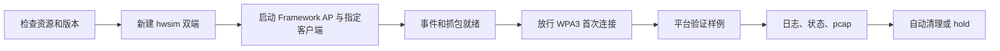

# ReconnectGuard 底层实验平台

| 项目 | 说明 |
|---|---|
| 当前范围 | 陈家森阶段一、二：架构、环境、双端控制和基础能力验证 |
| 平台示例 | AP Deauthentication：连接 → AP 断开 → 双端事件 → 自动重连 |
| 环境 | Linux + mac80211_hwsim；独立 AP/STA 网络命名空间 |
| AP | Wi-Fi Framework 修改版 hostapd |
| 客户端 | 先验证 Framework 自带客户端，再接入独立原版 wpa_supplicant |
| 固定安全配置 | WPA3-Personal、SAE、CCMP、PMF Required |
| 尚未实现 | 团队 Executor、Observer/Oracle、EFSM、自动测试调度 |

## 运行

在项目根目录执行；实验运行需要 sudo。默认完成验证后自动清理。

| 操作 | 命令 |
|---|---|
| 准备依赖与固定版本 | `bash scripts/setup.sh` |
| 检查基础工具和控制通道测试 | `bash scripts/check.sh` |
| Framework 双端连接 | `sudo bash scripts/start.sh --client framework --probe connect` |
| 原版客户端 AP Deauth 示例 | `sudo bash scripts/start.sh --client stock --probe deauth` |
| 主动断开 / 重连控制检查 | `sudo bash scripts/start.sh --client stock --probe reconnect` |
| 保持环境运行 | 在上述命令后加 `--hold` |
| 单独关闭保持运行的环境 | 另一终端执行 `sudo bash scripts/stop.sh` |
| 核实 Deauth 抓包 | `sudo vendor/wifi-framework/setup/venv/bin/python scripts/inspect_trace.py results/<run_id>` |

## 运行链路

## 目录

| 目录 / 文件 | 职责 |
|---|---|
| rg_platform/lab.py | hwsim、命名空间、进程、控制适配、基础快照、清理 |
| rg_platform/control.py | 标准协议 / Framework 前缀；独立命令和监听连接 |
| rg_platform/probes.py | 平台能力验证函数与注册表，不是完整 Executor |
| rg_platform/stop.py | 核实进程身份后停止本平台 |
| configs/ | 固定 WPA3 AP/客户端配置；密码仅供隔离虚拟实验 |
| scripts/ | 依赖准备、启停、静态检查、抓包核实 |
| tests/ | 命令协议与断开后查询回归测试 |
| vendor/ | 固定版本第三方依赖，不纳入自有代码 |
| results/ | 每轮证据；默认不提交 Git |
| work/ | 构建、安装日志与依赖锁定输出 |

## 资源与证据规则

| 规则 | 实现 |
|---|---|
| 不使用真实接口做断开测试 | 只移动本次新建的 hwsim PHY 到独立命名空间 |
| 不覆盖已有 hwsim 实验 | 检测模块已加载则拒绝启动 |
| 不重启系统网络服务 | 保留原有 NetworkManager 和系统 supplicant |
| 不全局解除 rfkill | Framework 小补丁省去全局 unblock |
| 不记录不必要密钥 | Framework 小补丁去除 -K 调试参数 |
| 正常重连不重启客户端 | 保持同一子进程，记录 process_epoch |
| 不混淆命令与效果 | 保存命令响应、双端事件和匹配的无线帧 |
| 快速自动重连 | 事件持续采集；快照保留当时实际状态 |
| 状态查询 FAIL | 原始值保留；不能自动解释为安全异常 |
| 缓存 / 认证路径 | 保存 PMKSA；auth_path 暂为 unknown |
| 清理 | 只停止自有进程和命名空间；仅在 PHY 集合属于本轮时卸载 hwsim |
| 时钟 | 保留 Kali 原始 UTC 事件和单调时间；不改主机时钟、不宣称跨主机已同步 |

## 每轮输出

| 文件 | 内容 |
|---|---|
| meta.json | 版本、配置、PHY、进程世代、原始命令响应 |
| ap.log / sta.log | 双端原始输出 |
| ap-events.jsonl / sta-events.jsonl | 平台验证用原始事件，不是最终 Observer 格式 |
| connected_baseline.json | 已连接基线与 PMKSA |
| post_deauth_observed.json | Deauth 后实际观测；可能已进入重连 |
| post_disconnect.json | 主动断开样例的状态 |
| post_reconnect.json | 恢复后的状态 |
| trace.pcap / capture.log | 报文及抓包进程记录 |
| platform-check.json | 平台检查，不是漏洞结论 |
| frame-check.json | 单独执行抓包核实脚本后生成 |
| cleanup.json / error.json | 清理结果 / 发生错误时的记录 |

## 扩展新的断开验证

| 步骤 | 做法 |
|---|---|
| 1 | 在 probes.py 新建函数，参数为 lab |
| 2 | 保存 connected_baseline，记录动作开始时间 |
| 3 | 调用 lab.command 发送目标端控制命令，写清 semantic |
| 4 | 等待实际事件；不要将 OK 当作动作效果 |
| 5 | 保存动作后实际快照，验证恢复及进程连续性 |
| 6 | 加入 PROBES 注册表；命令行自动出现新选项 |
| 7 | 独立核验对应帧与日志，未知结论保留 unknown |

现有 `deauth(lab)` 是参考模板。后续团队 Executor 接入时复用平台控制层，而不是把平台样例当作完整研究测试框架。

## 版本与兼容性

| 组件 | 固定 / 实测 |
|---|---|
| Framework | 7a173c1824caa95a848f351fe6eab2d5e5b389e1 |
| libwifi | 13ef752238984ea36da05f33a4d0706c816ec0f7 |
| Kali | 2026.2，内核 7.1.5+kali-amd64 |
| 原版 wpa_supplicant | Kali 系统程序 v2.10；来源软件包版本另存部署记录 |
| Python | Kali 3.14.7 |
| Python 兼容性调整 | PyCryptodome 从上游锁定 3.9.7 改为隔离 venv 中的 3.23.0 |

参考：[Wi-Fi Framework](https://github.com/domienschepers/wifi-framework)。四份阶段一设计文档未加入本代码包。
