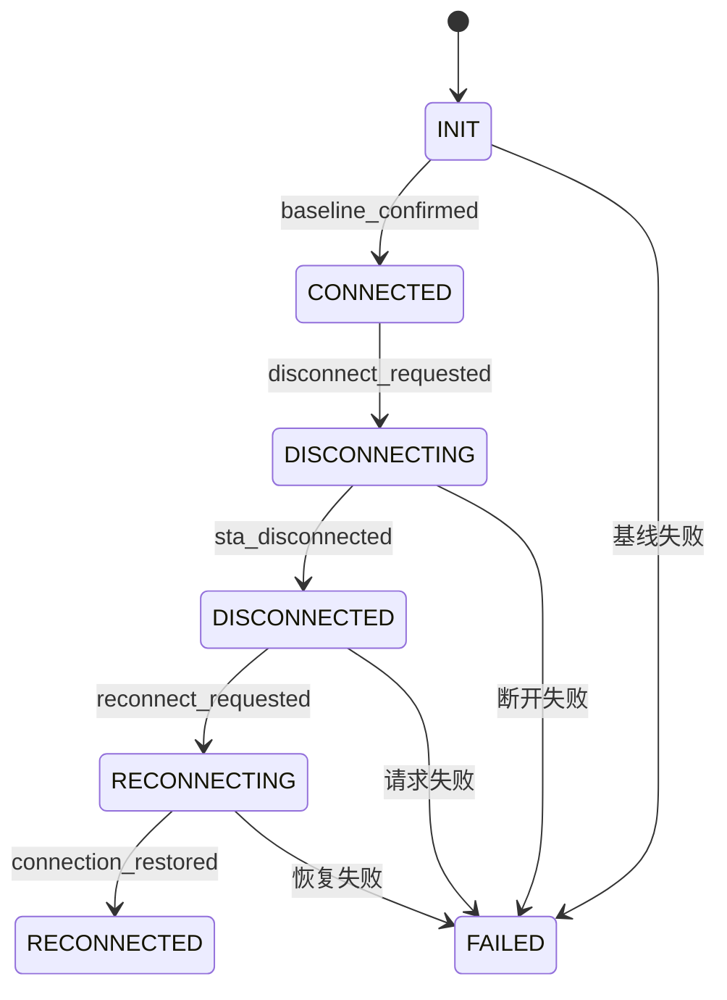

# 王奥鑫第一阶段：状态机与模拟测试

本实现用于第一阶段软件流程验收。依据团队 Proposal 的上下文连续性设计，先覆盖客户端主动断开。模拟结果不代表真实 Wi-Fi 测试结果。

## 使用

要求 Python 3.10 或更新版本。没有新增运行依赖。不需要 sudo、Linux 或无线网卡。

```sh
python3 runner.py --case client_disconnect_reconnect
python3 runner.py --scenario noisy_events
python3 runner.py --scenario disconnect_timeout
python3 runner.py --scenario reconnect_timeout
python3 -m unittest discover -s tests -v
```

正常和 noisy_events 返回退出码 0。两个超时场景返回退出码 1，并保存失败证据。案例配置错误返回退出码 2。

cases.yaml 使用 YAML 1.2 的 JSON 子集。当前加载器只接受 JSON 写法；不支持缩进式 YAML。这样可以在没有额外依赖的机器上演示。第一版校验固定五步案例，不宣称支持任意测试序列。

## 状态与转换



连接证据必须含 COMPLETED、SAE、CCMP、pmf=2。此检查只判断报告的配置，不证明授权时序。命令接受不直接产生 DISCONNECTED。完整 SAE、关联和密钥建立子状态留待真实观测支持。

初始连接 attempt_id=1；显式重连 attempt_id=2。同轮 run_id 不变。不同 run、不同 attempt、事件游标之前的事件和错误来源的事件不能推进模型。相同 event_id 只处理一次。无法归属的事件使用 attempt_id=null，不能完成等待。

## 接口与职责

- model/contracts.py：Context、Event、ActionReceipt、Executor 和 Observer 契约。
- model/efsm.py：纯状态转换，不执行平台命令。
- backends/mock.py：模拟动作、事件和快照；使用虚拟时钟。
- runner.py：第一阶段模拟调度、结果保存、退出码。

Observer.start 必须在动作之前调用；mark 返回监听事件游标。wait_event 只能返回游标之后、来源和上下文匹配的证据。真实后端需要单调时钟截止时间及持续事件消费；不能按收到事件时的当前 attempt_id 强行关联旧事件。

当前 Runner 直接使用 MockBackend，并通过 emit 生成测试器请求事件。Executor / Observer Protocol 是约定接口，尚未实现真实后端注入。真实接入时应将请求事件生成移到 Runner 的独立事件记录器，提供统一事件序号，并把后端作为参数注入。

## 现有平台接入对应关系

| 上层操作 | 当前平台入口 | 后续工作 |
|---|---|---|
| 启动 | Lab.start() | 已启动监听并放行首次连接，不能重复发起初始化 |
| 动作 | Lab.command() | Executor 封装 DISCONNECT / RECONNECT，保留回执 |
| 快照 | Lab.snapshot() | Observer 转换字段，保留原始响应 |
| 事件 | Lab.listen() / lab.events | 增加统一游标、事件归属和去重 |
| 恢复确认 | Lab.wait_connected() | 与当前尝试的事件证据关联 |
| 清理 | Lab.stop() | 成功、失败均执行；保存清理错误 |

不改动现有平台、Executor 或 Observer 的实际职责。真实环境应使用 stock 客户端。同一轮断开与重连之间不得重启客户端，也不得自动清空缓存。

## 输出与判定

每轮结果写入 results/<run_id>/：

| 文件 | 内容 |
|---|---|
| meta.json | 完整案例、模拟标志、场景、虚拟时钟类型 |
| actions.jsonl | 命令接受情况，效果仍为 unverified |
| events.jsonl | 原始模拟事件，包括错误来源、旧尝试和重复事件 |
| transitions.jsonl | 被接受的状态转换及失败原因 |
| snapshots.json | 基线、断开后、恢复后或失败现场 |
| observations.json | 等待时排除的候选事件及原因 |
| context.json | 最终上下文和证据引用 |
| result.json | 执行、恢复、配置、安全结论分别报告 |

不会生成虚假的 pcap 或 AP/STA 真实日志。模拟进程标识固定，仅用于演示进程连续性字段。缓存、密钥和授权事实保留 unknown。安全结论固定 not_evaluated。超时是恢复或观测问题，不是漏洞结论。

重复事件保留在原始记录中。等待器匹配到首个有效事件就返回；其后的重复事件不再驱动模型。EFSM 单元测试独立验证重复交付不会重复推进。

## 第一阶段验收与后续边界

1. 正常模拟流程经过五条转换，输出 RECONNECTED。
2. 断开超时停在第二步，不发送重连动作。
3. 重连超时停在第四步，保存失败快照。
4. 旧尝试和错误来源事件不能完成当前等待。
5. 非法转换被拒绝，重复事件不增加转换次数。
6. 所有结果明确标记 simulated=true。

5 秒和 20 秒是预实验起始参数，不是协议要求。mock 超时使用虚拟时钟，不验证真实等待精度。真实双端一致性、自动重连、AP Deauth/Disassoc、授权时序、缓存使用判定、覆盖率分母和自动序列生成尚未实现。covered_transitions 只列出当前模型路径，包括失败边；不能解释为协议覆盖率。

下一步与三位成员核对事件和回执字段，然后在 Linux 上接入真实主动断开流程。配对实验应固定版本、配置及初始缓存条件，分别记录显式重连和自动恢复。
