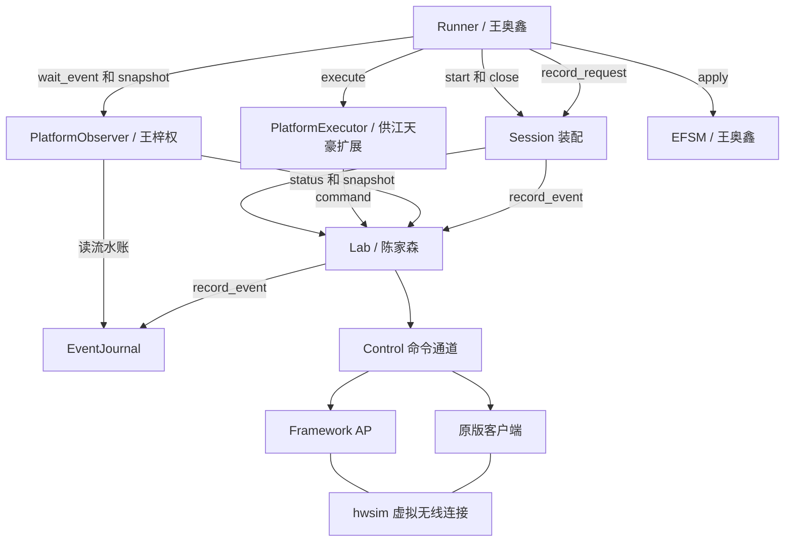
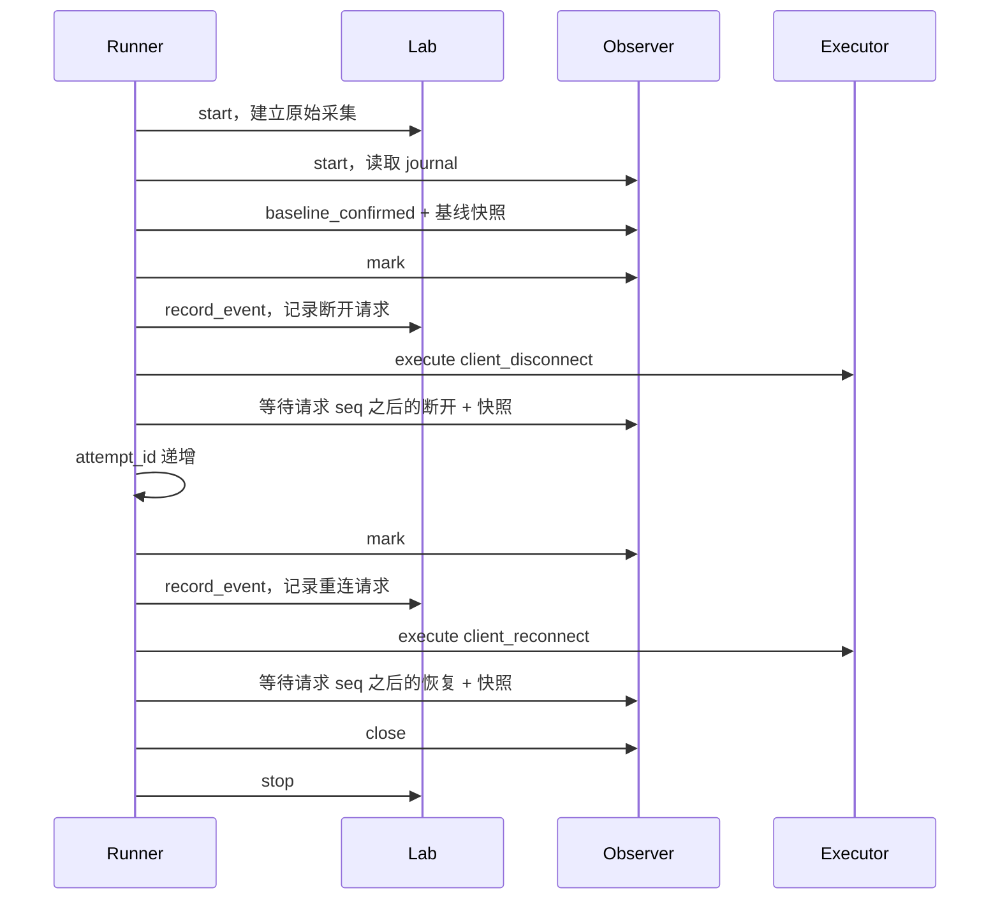

# 给组员的接口说明

版本：1，2026-10-23。对应本次真实 Runner 接入代码。本文是当前调用约定，不是未来功能清单。

## 先看这张图

## 模块负责人及协作边界

基础接线已完成。下表说明各模块由谁维护、后续如何协作，不要求四个人重新接入一次。陈家森是平台提供方。

| 负责人 | 负责维护的模块 | 后续工作 | 与其他模块的边界 |
|---|---|---|---|
| 王奥鑫 | runner.py、model/、backends/sessions.py | 维护实验流程和状态机，在现有接线上扩展案例与调度 | 调用平台、Executor 和 Observer；复用 Lab 的 run_id、结果目录与事件序号 |
| 江天豪 | backends/platform_executor.py | 维护客户端断开/重连与 AP Deauth/Disassoc 动作 | 通过 Lab.command 发命令；不直接改 EFSM 状态；OK 只表示命令接受 |
| 王梓权 | backends/platform_observer.py、rg_platform/journal.py 的观测接口 | 完善事件标准化、状态快照与证据处理；journal 底层变更与陈家森协调 | 通过 journal 读取事件，不争抢 Lab 的控制 socket；保留原始证据引用 |
| 陈家森（平台提供方） | rg_platform/lab.py、rg_platform/control.py；journal 的底层记录入口 | 提供并维护环境启停、进程、控制通道、事件记录与失败清理；支持其他成员联调 | 一轮中不重启客户端；清理失败阻止下一轮；接口变动同步其他三人，无需再次接入平台 |

## 入口命令

| 用途 | 项目根目录执行 |
|---|---|
| 原来的模拟案例 | `python runner.py` |
| 模拟 AP Deauth 案例 | `python runner.py --case ap_deauth` |
| 模拟 AP Disassoc 案例 | `python runner.py --case ap_disassoc` |
| 模拟噪声事件 | `python runner.py --scenario noisy_events` |
| 真实 PoC 1 | `sudo python3 runner.py --backend real --client stock` |
| 真实 AP Deauth 案例 | `sudo python3 runner.py --case ap_deauth --backend real --client stock` |
| 真实 AP Disassoc 案例 | `sudo python3 runner.py --case ap_disassoc --backend real --client stock` |
| 真实十轮 | `sudo python3 runner.py --backend real --client stock --repeat 10` |
| 指定结果根目录 | 加 `--output /absolute/path/to/results` |
| 平台自检 | `sudo bash scripts/start.sh --client stock --probe deauth` |
| 平台 Disassoc 自检 | `sudo bash scripts/start.sh --client stock --probe disassoc` |

如使用仓库 .venv，真实 Runner 改用 `sudo .venv/bin/python runner.py ...`。真实模式只在 Linux 运行，不接受 mock 的故障 scenario。客户端主动断开使用显式重连；AP Deauth/Disassoc 使用自动恢复案例，真实 Linux 轮次仍需单独验收。

## 平台对外方法

| 方法 | 输入 | 返回 / 效果 |
|---|---|---|
| `Lab(mode, *, output_root=None)` | stock / framework，结果根目录 | 创建唯一 run_id、out；需要 Linux 权限 |
| `start()` | 无 | 准备双端、监听和抓包，再 ENABLE_NETWORK；不承诺返回时已连上 |
| `command(target, command, semantic, allow_rejected=False)` | ap/sta、协议命令、动作名 | 原始响应 str；拒绝默认抛错，允许读取拒绝时必须自行处理 |
| `status()` | 无 | 客户端 STATUS 字典 |
| `snapshot(checkpoint)` | 安全的检查点名 | 原始字典，同时写 checkpoint.json |
| `record_event(source, raw_event, attempt_id=None)` | 原文及归属 | RawEvent；分配 seq，追加 events.jsonl |
| `check_health()` | 无 | 正常无返回；采集错误或子进程退出则抛 BackendError |
| `stop()` | 无 | `{errors: [...]}`；正常重复调用返回原清理结果 |

内部属性 spawn、listen、套接字和 Lab.events 不作为新模块接口。不要向系统无线接口发实验命令；Lab 只管理自己创建的 hwsim 资源。

## Runner 的装配接口

| Session 成员 | 内容 |
|---|---|
| context | Context，真实 run_id 来自 Lab |
| out | 本轮唯一结果目录 |
| simulated | mock=true，real=false |
| executor / observer | 分别遵守下方接口 |
| start() | 启动环境与 Observer |
| record_request(kind) → Event | 记录 disconnect_requested / reconnect_requested，使用共享 seq |
| close() → dict | 先关闭 Observer，再清理 Lab；返回 errors |
| metadata() / events() | 平台元数据及标准事件，供 Runner 保存 |

`run_case(case, output_root, scenario="normal", *, backend=None, client="stock", session_factory=None)` 返回 `(result, out)`。日常调用使用 backend；替换组合或测试时注入 session_factory(output_root, scenario, client)。循环中的流程代码不应因 mock/real 写两份。

## Executor 接口

`execute(action: str, context: Context) -> ActionReceipt`

| action | 目标 | 命令 | 当前支持 |
|---|---|---|---|
| client_disconnect | sta | DISCONNECT | 已接入 |
| client_reconnect | sta | RECONNECT | 已接入 |
| ap_deauth | ap | DEAUTHENTICATE `<STA_MAC>` reason=3 | Executor 与 Runner 案例已接入 |
| ap_disassoc | ap | DISASSOCIATE `<STA_MAC>` reason=3 | Executor 与 Runner 案例已接入 |

| 回执字段 | 说明 |
|---|---|
| action_id、action、accepted | 动作编号、动作名、命令是否接受 |
| effect_status | 固定 unverified，效果由观测决定 |
| run_id、attempt_id | 继承 Context，不另行生成 |
| target、command、raw_response | 实际发送与原始响应 |
| started_at_utc、finished_at_utc、duration_ms | UTC 用于查阅，耗时使用单调时钟 |
| error_category | action_rejected / action_timeout / control_unavailable，成功为 null；非法目标在调用前抛 `invalid_target` |

AP 动作发送前通过客户端 `STATUS` 读取并校验 `address` 字段，避免把未经校验的字符串拼入控制命令。
调用失败时先保存回执，Runner 再进入失败分支。控制超时不自动重发，因为命令可能已经生效。
健康检查未通过、不支持的动作或找不到有效 STA MAC 时直接抛 `BackendError`。

## Observer 接口

| 方法 | 返回 | 说明 |
|---|---|---|
| start() | None | 启用适配器；不新开控制监听 socket |
| mark() | int | 当前 journal 游标 |
| wait_event(expected, after, timeout, context) | Event | 只接受游标之后的匹配观测 |
| snapshot(checkpoint) | dict | 写标准快照并保留原始快照引用 |
| close() | None | 关闭适配器，不关闭 Lab |

| expected | 什么证据才接受 |
|---|---|
| baseline_confirmed | 客户端 CONNECTED 事件，加当前 COMPLETED 状态 |
| sta_disconnected | 客户端 DISCONNECTED 事件 |
| connection_restored | 客户端 CONNECTED 事件，加当前 COMPLETED 状态 |

连接的 SAE、CCMP、PMF 要求由 EFSM 继续校验。AP 事件可保留在原始证据，但不能冒充客户端连接事件。原始 attempt_id 为空时，标准事件注明 received_after_cursor；这不证明精确的无线尝试归属。

## 事件和编号

| 字段 | 约定 |
|---|---|
| run_id | 真实模式只有 Lab 一个生成者 |
| seq | 原始事件和 Runner 请求共用 journal；每轮从 1 递增 |
| event_id | 标准事件包含 run_id、原始 seq、事件类型 |
| attempt_id | 基线与主动断开为 1；显式重连前递增为 2；原始未知归属仍为 null |
| source | runner / ap / sta；Observer 不改原始来源 |
| monotonic_s | 同机计时；不拿不同主机的单调时钟直接比较 |
| data.evidence_ref | 如 events.jsonl#seq=24，必须能回到原文 |

## 一轮调用顺序

每次收到标准观测，Runner 用 EFSM.apply 更新状态；命令回执不推动效果状态。首次采集在 Lab.start 内先就绪，Observer 后续读取已有 journal，因此不会因后创建适配器而丢掉已入账的首次连接。

AP Deauth/Disassoc 案例在断开事件后递增 `attempt_id`，再等待客户端自动恢复；原始断开和恢复事件仍通过同一个 journal 游标关联。客户端主动断开案例继续使用显式 `client_reconnect`。

## 输出由谁写

| 文件 | 写入者 | 规则 |
|---|---|---|
| meta.json | Lab 基础信息，Runner 合并案例信息 | 不覆盖版本、进程和程序摘要 |
| events.jsonl | Lab | 真实原始流水账；Runner 不覆盖 |
| ap.log / sta.log / trace.pcap | Lab 管理的进程 | 保留原始证据 |
| observer-events.jsonl | Observer | 标准观测事件 |
| observer-observations.jsonl | Observer | 被过滤事件及原因 |
| checkpoint.json / checkpoint-observer.json | Lab / Observer | 原始快照 / 标准快照 |
| runner-events.jsonl | Runner | 真实模式：标准请求和观测的集合 |
| actions.jsonl / transitions.jsonl | Runner | 动作回执 / EFSM 转换 |
| snapshots.json / context.json | Runner | 本轮标准快照及上下文 |
| result.json | Runner | 执行与恢复结果，未做漏洞判定 |
| cleanup.json / runner-cleanup.json | Lab / Runner | 资源清理记录 / Session 关闭结果 |
| batch-编号.json | Runner | 多轮目录、成功数和各轮结果 |

mock 仍用 events.jsonl 保存模拟事件，且 simulated=true。真实 raw 文件不能被标准化输出覆盖。checkpoint 使用预定义安全文件名，不接收包含路径分隔符的名称。

## 失败怎么处理

| 类别 | Runner 行为 |
|---|---|
| action_rejected / action_timeout / control_unavailable | 保存回执和失败快照，停止本轮 |
| observation_timeout | 保存观测记录；不自动视为漏洞 |
| process_exit / collection_error | 停止等待，保留原因，清理环境 |
| environment_error | 启动失败也尝试关闭已创建资源 |
| cleanup_error | 本轮失败；禁止继续下一轮 |
| artifact_write_error | 返回错误；无法写盘时不能承诺完整产物 |

认证路径、密钥状态和授权时序没有足够证据时仍为 unknown / insufficient_evidence。AP 的 AUTHORIZED 快照只说明当时的标志，不证明授权时序安全。
